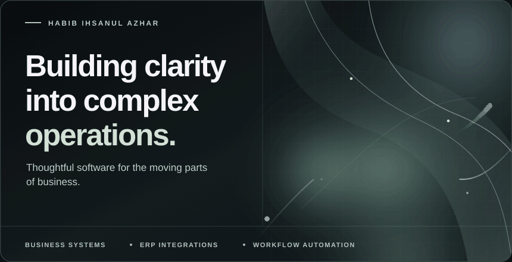
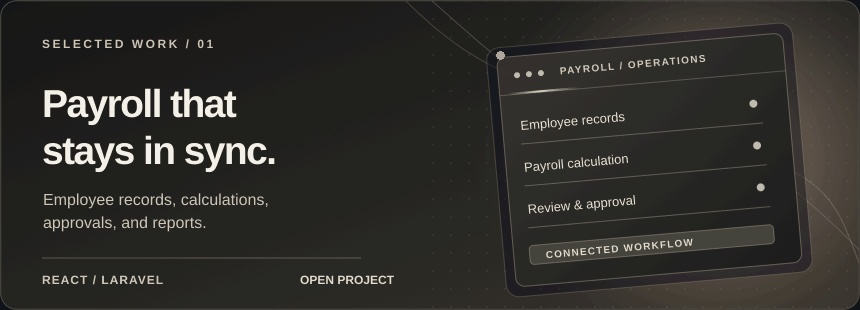
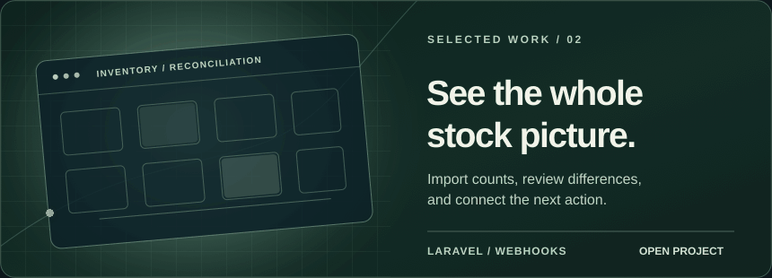

  

  

  

  

  <a href="https://github.com/HabibIhsanul15?tab=repositories">Explore repositories</a>
  &nbsp; · &nbsp;
  <a href="https://www.linkedin.com/in/habib-ihsanul-azhar-90166530a/">LinkedIn</a>
  &nbsp; · &nbsp;
  <a href="mailto:habibihsanul2018@gmail.com">Email</a>

