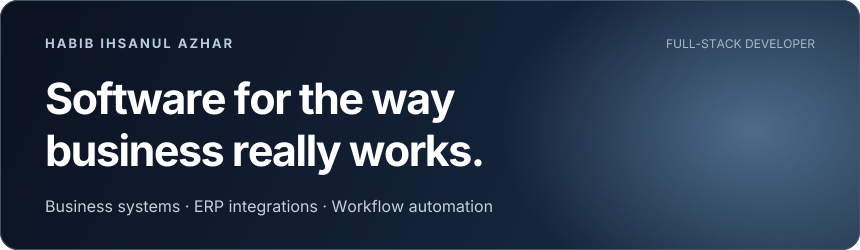
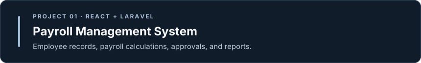
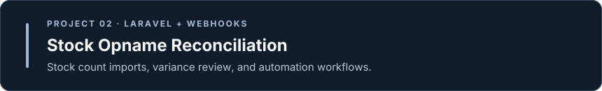

## About

I build applications that make business operations easier to manage. My work spans payroll, inventory reconciliation, and integrations between systems.

## Selected work

## Tools and interests

**Working with** React · Laravel · JavaScript · PHP\
**Currently exploring** Next.js · NestJS · PostgreSQL · Prisma

[View all repositories](https://github.com/HabibIhsanul15?tab=repositories)

Visuals generated with [readme-aura](https://github.com/collectioneur/readme-aura).
